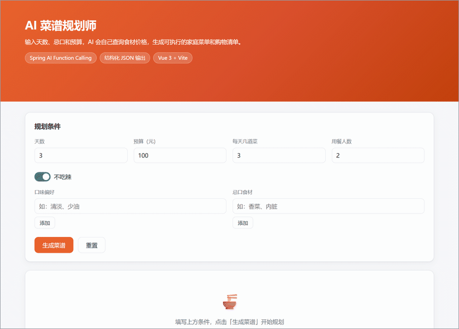

<div align="center">

# 🍜 AI 菜谱规划师

**输入「3 天、不吃辣、预算 100 元」，AI 自己查询食材价格，生成菜谱与购物清单。**

[](https://docs.spring.io/spring-ai/reference/)
[](https://spring.io/projects/spring-boot)
[](https://vuejs.org/)
[](https://openjdk.org/)
[](LICENSE)

</div>

## 演示



> 上面这段 GIF 是**真实浏览器录制**的：脚本驱动 Chrome 填写条件、点击生成、勾选购物清单、
> 导出 TXT，每一帧都是实际运行的界面。录制脚本见 `frontend/scripts/record-demo.mjs`。

## 它和普通菜谱网站有什么不同

模型**不知道**食材价格。

普通做法是让大模型直接生成菜谱，价格靠模型"编"——结果通常是"约 20 元"这种没法核对的数字。

这个项目里，模型要报价就必须**自己发起函数调用**：

```
模型：我要做宫保鸡丁，先查一下鸡胸肉和豆瓣酱多少钱
        ↓ tool_calls: lookupIngredientPrices(["鸡胸肉", "豆瓣酱"])
Java：  @Tool 方法执行，返回真实单价
        ↓
模型：鸡胸肉 500g 9.90 元……好，这道菜成本 12.4 元，在预算内
```

后端会把模型实际发起过的调用记录在响应的 `toolCalls` 字段里，可以直接验证：

```json
"toolCalls": [
  {
    "tool": "lookupIngredientPrices",
    "arguments": "{\"names\": [\"番茄\", \"鸡蛋\", \"鸡胸肉\", \"西兰花\"]}",
    "result": "[{\"found\":true,\"name\":\"鸡胸肉\",\"unit\":\"500g\",\"unitPrice\":9.9,...}]"
  }
]
```

## 技术亮点

### 后端：Spring AI Function Calling

```java
@Tool(name = "lookupIngredientPrices",
      description = """
              批量查询多个食材的单价（单位：人民币元），用于一次性为一道菜或一天的菜单估算成本。
              参数 names 是中文食材名数组。返回数组，每项含 name、unit、unitPrice、category、found。""")
public String lookupIngredientPrices(
        @ToolParam(description = "食材名称数组，使用中文，例如 [\"鸡胸肉\", \"番茄\"]", required = true)
        List<String> names) {
    // ...
}
```

三个工具函数：`lookupIngredientPrice`（单个）、`lookupIngredientPrices`（批量）、
`estimateDishCost`（按食材清单估一道菜）。

### 后端：结构化输出

```java
MealPlan plan = spec.entity(MealPlan.class);
```

`BeanOutputConverter` 依据 `MealPlan` record 的定义生成 JSON Schema，把模型输出强制转成对象。
不是从自由文本里正则抠 JSON，是有类型保证的。

### 前端：卡片式菜谱 + 可勾选清单

Vue 3 + Vite，纯展示型 UI，不需要状态管理库。购物清单逐项勾选、实时统计已购/待购金额，
一键导出 TXT。

## 快速开始

### Docker Compose

```bash
export OPENAI_API_KEY=sk-xxxx
export OPENAI_BASE_URL=https://api.openai.com
export OPENAI_MODEL=gpt-4o-mini

docker compose up --build
```

打开 <http://localhost:5173>。

### 本地开发

```bash
# 后端
cd backend && mvn spring-boot:run

# 前端
cd frontend && npm install && npm run dev
```

### 没有 API Key？

仓库自带一个 OpenAI 兼容的 mock 服务，会**真的走一遍**「模型请求工具 → 工具返回价格 → 模型给出菜单」：

```bash
python tools/mock_openai_server.py --port 8095

cd backend && mvn spring-boot:run \
  -Dspring-boot.run.arguments="--spring.ai.openai.base-url=http://127.0.0.1:8095 --spring.ai.openai.api-key=mock --spring.ai.openai.chat.options.model=mock-model"
```

一键跑完整验证：

```bash
bash scripts/verify.sh      # 后端接口端到端验证
bash scripts/ui-verify.sh   # 真实浏览器验证 + 截图
```

## 支持的模型端点

任何 OpenAI 兼容协议的服务都可以，改三个环境变量即可：

| 服务 | `OPENAI_BASE_URL` | `OPENAI_MODEL` |
| --- | --- | --- |
| OpenAI | `https://api.openai.com` | `gpt-4o-mini` |
| DeepSeek | `https://api.deepseek.com` | `deepseek-chat` |
| 阿里云百炼 | `https://dashscope.aliyuncs.com/compatible-mode` | `qwen-plus` |
| Ollama | `http://localhost:11434` | `qwen2.5:7b` |
| vLLM | `http://your-host:8000` | 你的模型名 |

> 模型需要支持 function calling，`qwen2.5`、`llama3.1`、`gpt-4o` 等都可以。

## 项目结构

```
backend/                  Spring AI 后端
  src/main/java/com/mealplanner/
    tool/                 @Tool 函数、调用轨迹记录 advisor
    service/              规划逻辑、购物清单合并
    model/                领域模型（record）
    controller/           REST 接口
    config/               ChatClient、OpenAPI、CORS
frontend/                 Vue 3 前端
  src/components/         菜谱卡片、购物清单、表单
  scripts/                浏览器验证与录制脚本
docs/                     MkDocs 文档站点
tools/                    mock 模型服务、GIF 合成
scripts/                  本地运行与验证脚本
.devcontainer/            Dev Container
.github/workflows/        CI、发版、安全扫描
```

## 文档

| 文档 | 地址 |
| --- | --- |
| 文档站点 | <https://example.github.io/meal-planner/> |
| Swagger UI | <http://localhost:8080/swagger-ui.html> |
| OpenAPI 规范 | <http://localhost:8080/v3/api-docs> |

- [快速开始](docs/quickstart.md) —— 配置模型、跑起来
- [架构设计](docs/architecture.md) —— Function Calling 的实现细节与踩坑记录
- [API 参考](docs/api.md) —— 完整接口定义
- [开发指南](docs/development.md) —— 怎么改价格库、怎么加工具函数
- [运维与发布](docs/operations.md) —— Docker、发版、安全扫描

## 工程化

| 能力 | 实现 |
| --- | --- |
| 运行 | Docker Compose（多阶段构建）、Dev Container |
| CI | GitHub Actions：后端测试、前端类型检查、端到端接口验证、镜像构建 |
| 发版 | Release Please + Conventional Commits，自动打 tag、发 Release、推镜像到 GHCR |
| 安全扫描 | CodeQL（SAST）、Trivy（镜像漏洞）、Gitleaks（密钥泄露）、Dependency Review（依赖变更） |
| 文档 | MkDocs Material → GitHub Pages，springdoc → OpenAPI |

## 踩过的坑

记录在 [架构设计文档](docs/architecture.md) 里，最值得说的两个：

**1. 只注册工具不注册 `ToolCallAdvisor`，工具永远不会被执行。**
Spring AI 会把工具定义发给模型，但执行函数调用循环的是 `ToolCallAdvisor`。
少了它，模型会一直请求工具，却拿不到结果。

**2. 想拿到函数调用轨迹，不能直接读最终的 `ChatResponse`。**
`ToolCallAdvisor` 内部会 `copy(this)` 重建 advisor 链再循环调用模型，
最终返回的响应只包含**最后一轮**，中间的 tool calls 已经丢了。
解法是挂一个 order 排在 `ToolCallAdvisor` **之后**的 advisor 逐轮记录——
而且别覆盖它的 `adviseCall()`，否则 `BaseAdvisor` 默认的 `after()` 就不会被调用。

## License

[Apache-2.0](LICENSE)
