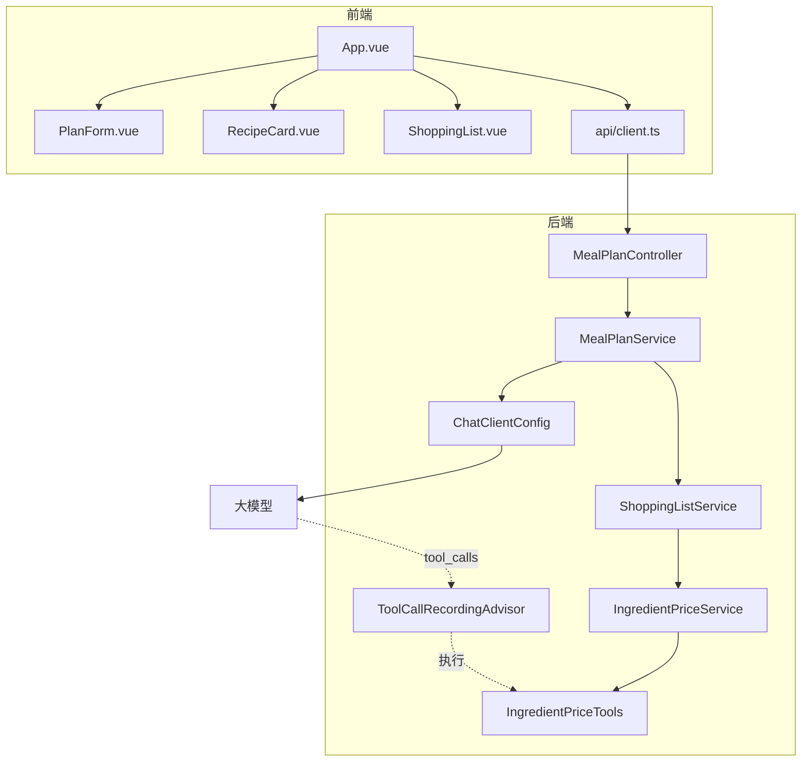

# 架构设计

## 模块划分



## 三、模型自己调用价格函数

这是后端最核心的部分。

### 1. 用 `@Tool` 声明函数

`backend/src/main/java/com/mealplanner/tool/IngredientPriceTools.java`

```java
@Tool(name = "lookupIngredientPrices",
      description = """
              批量查询多个食材的单价（单位：人民币元），用于一次性为一道菜或一天的菜单估算成本。
              参数 names 是中文食材名数组。返回数组，每项含 name、unit、unitPrice、category、found。""")
public String lookupIngredientPrices(
        @ToolParam(description = "食材名称数组，使用中文，例如 [\"鸡胸肉\", \"番茄\"]", required = true)
        List<String> names) {
    // ...
}
```

`@Tool` 的 `description` 就是给模型看的说明书——**写清楚工具的用途和参数格式，模型才会用对**。

### 2. 注册成 ToolCallbackProvider

```java
@Bean
public ToolCallbackProvider ingredientToolProvider(IngredientPriceTools priceTools) {
    return MethodToolCallbackProvider.builder().toolObjects(priceTools).build();
}
```

Spring AI 会把这个对象里所有 `@Tool` 方法的 JSON Schema 发给模型。

### 3. 挂上 ToolCallAdvisor

```java
@Bean
public ChatClient chatClient(ChatModel chatModel, ToolCallbackProvider ingredientToolProvider,
        ToolCallingManager toolCallingManager) {
    return ChatClient.builder(chatModel)
            .defaultToolCallbacks(ingredientToolProvider)
            .defaultAdvisors(
                    ToolCallRecordingAdvisorHolder.ADVISOR,
                    ToolCallAdvisor.builder().toolCallingManager(toolCallingManager).build())
            .build();
}
```

!!! warning "容易踩的坑"
    `ToolCallAdvisor` 是执行函数调用循环的 advisor。**只注册工具不注册它，工具会被告知给模型但永远不会执行。**
    另外 `defaultToolCallbacks` 和请求级 `.tools(...)` 不要同时用同名工具，
    Spring AI 会直接抛 `Multiple tools with the same name`。

### 4. 结构化输出

```java
CallResponseSpec spec = chatClient.prompt()
        .system(systemPrompt(request))
        .user(userPrompt(request))
        .call();

MealPlan plan = spec.entity(MealPlan.class);
```

`entity(Class)` 内部用 `BeanOutputConverter`，会根据 `MealPlan` 的 record 定义生成 JSON Schema，
并在模型输出后强制反序列化成对象。

## 四、如何拿到函数调用轨迹

这是个容易踩的坑：**最终返回的 `ChatResponse` 只包含最后一轮对话**，中间的 tool call 已经不在里面了。

原因在 `ToolCallAdvisor` 内部：

```java
chatClientResponse = callAdvisorChain.copy(this).nextCall(processedChatClientRequest);
```

`copy(this)` 会**只保留自己之后的 advisor**并重建链，然后循环调用模型直到没有 tool calls。

所以要拿到每一轮的 tool calls，需要一个排在 `ToolCallAdvisor` **之后**的 advisor：

```java
public class ToolCallRecordingAdvisor implements CallAdvisor, BaseAdvisor {

    @Override
    public int getOrder() {
        // ToolCallAdvisor 的默认 order 是 HIGHEST_PRECEDENCE + 300
        return BaseAdvisor.HIGHEST_PRECEDENCE + 301;
    }

    @Override
    public ChatClientResponse after(ChatClientResponse response, AdvisorChain chain) {
        record(response);   // 每一轮都会经过这里
        return response;
    }
}
```

两个关键点：

1. **order 必须在 `ToolCallAdvisor` 之后**，否则重建链时会把它排除掉，永远看不到中间的 tool calls。
2. **不要覆盖 `adviseCall()`**。`BaseAdvisor` 的默认实现会在链的两端调用 `before()`/`after()`；
   一旦自己覆盖 `adviseCall()` 直接 `chain.nextCall()`，`after()` 就再也不会被调用。

## 五、购物清单合并

模型给出的菜谱里，同一种食材会出现在多道菜中。`ShoppingListService` 负责合并：

```java
Map<String, Accumulator> merged = new LinkedHashMap<>();
for (var day : plan.days()) {
    for (Recipe recipe : day.meals()) {
        for (Ingredient ingredient : recipe.ingredients()) {
            String key = ingredient.name().trim().toLowerCase(Locale.ROOT);
            Accumulator acc = merged.computeIfAbsent(key,
                    k -> new Accumulator(ingredient.name(), ingredient.unit()));
            acc.quantity += ingredient.quantity();
            acc.usedIn.add(recipe.name());
        }
    }
}
```

合并后重新按价格库计价，保证 **UI 显示的金额 = 模型规划时看到的单价**。

## 数据模型

```
MealPlan
├── days: List<DayPlan>
│   └── DayPlan
│       ├── day: int
│       ├── label: String
│       ├── meals: List<Recipe>
│       │   └── Recipe
│       │       ├── name, description, category, spicyLevel
│       │       ├── cookingMinutes, servings
│       │       ├── ingredients: List<Ingredient>
│       │       └── steps: List<String>
│       └── estimatedCost: double
├── estimatedTotalCost: double
├── estimatedShoppingCost: double
├── summary: String
├── tips: List<String>
└── toolCallsUsed: List<String>
```

全部使用 Java `record`，Jackson 与 `BeanOutputConverter` 都能直接处理。

## 价格计算规则

价格库里的每条记录带**计价单位**（如 `500g`、`10个`），换算时统一折算到基准单位：

| 输入单位 | 基准单位 | 系数 |
| --- | --- | --- |
| `kg` / `千克` / `公斤` | g | ×1000 |
| `g` / `克` | g | ×1 |
| `l` / `升` | ml | ×1000 |
| `ml` / `毫升` | ml | ×1 |
| 其他（`个`、`把`…） | 原样 | ×1 |

```java
double base = toBaseUnits(quantity, unit);                       // 300g -> 300
double packSize = toBaseUnits(parsePriceQuantity(price.unit()),   // "500g" -> 500
        parsePriceUnitName(price.unit()));
double cost = base / packSize * price.unitPrice();               // 300/500 * 9.90 = 5.94
```

同一套换算逻辑由 `IngredientPriceTools` 和 `IngredientPriceService` 共享，
工具返回值与购物清单金额不会漂移。

## 前端设计

纯展示型 UI，不需要 Pinia 之类的状态管理：

- `App.vue` 持有唯一的 `response` 状态，`computed` 派生预算占用率、总价等派生数据。
- `ShoppingList.vue` 接收 `checked: Set<string>`，勾选状态由父组件持有，勾选时整体替换 Set 触发更新。
- 导出走 `Blob` + `URL.createObjectURL`，无需后端接口。

```
frontend/src/
├── App.vue                    # 页面编排、请求、导出
├── components/
│   ├── PlanForm.vue           # 输入表单
│   ├── RecipeCard.vue         # 单道菜的卡片
│   └── ShoppingList.vue       # 可勾选清单
├── api/client.ts              # fetch 封装
├── types.ts                   # 与后端 DTO 对应的类型
└── assets/main.css            # 全部样式
```

## 错误处理

`GlobalExceptionHandler` 统一处理：

| 异常 | 状态码 | 响应 |
| --- | --- | --- |
| `MethodArgumentNotValidException` | 400 | 字段级校验错误 |
| `HttpMessageNotReadableException` | 400 | 请求体格式错误 |
| 其他异常 | 500 | 异常信息 + 请求路径 |
