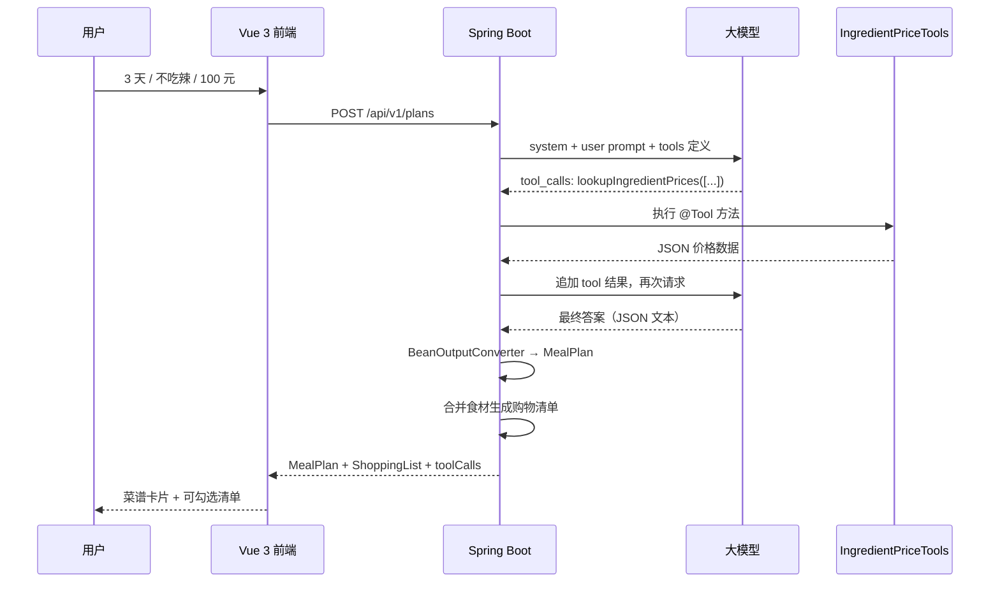

# AI 菜谱规划师

输入「3 天、不吃辣、预算 100 元」，AI 生成可执行的家庭菜单和购物清单。

后端用 **Spring AI**，模型会**自己调用**你写的「食材价格查询」函数来获取真实单价，而不是凭空编造价格。

## 核心特性

- **Function Calling**

    模型在规划过程中自行决定查询哪些食材的价格。Spring AI 把 `@Tool` 注解的方法注册给模型，模型发起调用后由 Java 代码执行，结果再喂回对话。

    [查看实现](architecture.md#function-calling)

- **结构化输出**

    最终结果通过 `BeanOutputConverter` 转换为 `MealPlan` JSON 结构，字段有类型保证，不需要从自由文本里正则抠 JSON。

    [查看数据模型](architecture.md#数据模型)

- **卡片式前端**

    Vue 3 + Vite，按天分组展示菜谱卡片；购物清单可逐项勾选，一键导出 TXT。

    [查看前端](development.md#前端)

- **工程化交付**

    Docker Compose 一键起栈，Dev Container 开箱即用，GitHub Actions 负责 CI、Release Please 发版与三层安全扫描。

    [查看部署](operations.md)

## 技术栈

| 层次 | 技术 |
| --- | --- |
| 后端 | Java 21 · Spring Boot 3.5 · Spring AI 1.1 |
| 模型接入 | OpenAI 兼容协议（OpenAI / DeepSeek / Qwen / Kimi / Ollama / vLLM） |
| 前端 | Vue 3 · Vite 6 · TypeScript |
| 文档 | MkDocs Material · springdoc-openapi |
| 运行 | Docker Compose · Dev Container |
| 协作 | GitHub Actions · Release Please · CodeQL / Trivy / Gitleaks |

## 一次调用的完整链路

## 快速入口

- 想要**跑起来** → [快速开始](quickstart.md)
- 想理解**实现原理** → [架构设计](architecture.md)
- 想调**接口** → [API 参考](api.md)
- 想**参与开发** → [开发指南](development.md)
- 想**部署上线** → [运维与发布](operations.md)
